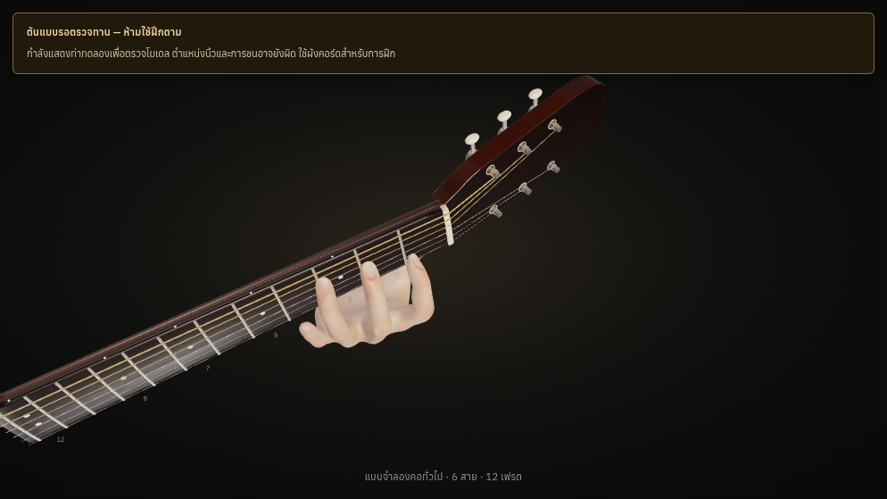

# Actual final screenshots

These are actual production WebGL screenshots. The hand remains **needs-review**, not an anatomically approved teaching example. No photo or prerecorded animation replaces the mesh.

## C — four actual camera views

[Default](tests/reports/trainers-retest/chromium/UNAPPROVED-prototype-desktop-C-angle.png) · [Side](tests/reports/trainers-retest/chromium/UNAPPROVED-prototype-desktop-C-side.png) · [Behind neck](tests/reports/trainers-retest/chromium/UNAPPROVED-prototype-desktop-C-back.png) · [Player](tests/reports/trainers-retest/chromium/UNAPPROVED-prototype-desktop-C-player.png)

## Corrected player camera

[Before: rear-neck occlusion](../practice-hand-batch-3/tests/reports/chromium/UNAPPROVED-prototype-desktop-C-player.png). The same guitar and hand now show the fingerboard side; the pose itself is unchanged. This is a camera correction, not a claim of improved anatomy.

## Tablet/mobile and engine comparison

- chromium desktop: [default](tests/reports/final/inspection-gates/UNAPPROVED-chromium-desktop-C-angle.png), [player](tests/reports/final/inspection-gates/UNAPPROVED-chromium-desktop-C-player.png).
- chromium tablet: [default](tests/reports/final/inspection-gates/UNAPPROVED-chromium-tablet-C-angle.png), [player](tests/reports/final/inspection-gates/UNAPPROVED-chromium-tablet-C-player.png).
- chromium mobile: [default](tests/reports/final/inspection-gates/UNAPPROVED-chromium-mobile-C-angle.png), [player](tests/reports/final/inspection-gates/UNAPPROVED-chromium-mobile-C-player.png).
- webkit desktop: [default](tests/reports/final/inspection-gates/UNAPPROVED-webkit-desktop-C-angle.png), [player](tests/reports/final/inspection-gates/UNAPPROVED-webkit-desktop-C-player.png).
- webkit tablet: [default](tests/reports/final/inspection-gates/UNAPPROVED-webkit-tablet-C-angle.png), [player](tests/reports/final/inspection-gates/UNAPPROVED-webkit-tablet-C-player.png).
- webkit mobile: [default](tests/reports/final/inspection-gates/UNAPPROVED-webkit-mobile-C-angle.png), [player](tests/reports/final/inspection-gates/UNAPPROVED-webkit-mobile-C-player.png).

The [all 42 gate report](tests/reports/final/inspection-gates/inspection-gate-browser.json) binds each actual root/bone fingerprint to the source. It checks all seven allowed prototypes with changed real pixels, all 35 rejected controls/diagram fallbacks, and 12 corrected camera captures.

[Chromium canonical captures](tests/reports/trainers-retest/chromium/) and [WebKit canonical captures](tests/reports/trainers-retest/webkit/) include C four-view desktop/tablet/mobile inspection and geometry-rejected F fallback images. [Reveal captures](tests/reports/final/hand-reveal/) explicitly label the controlled-clock half-opacity evidence. None establishes physical iPad Safari approval.
