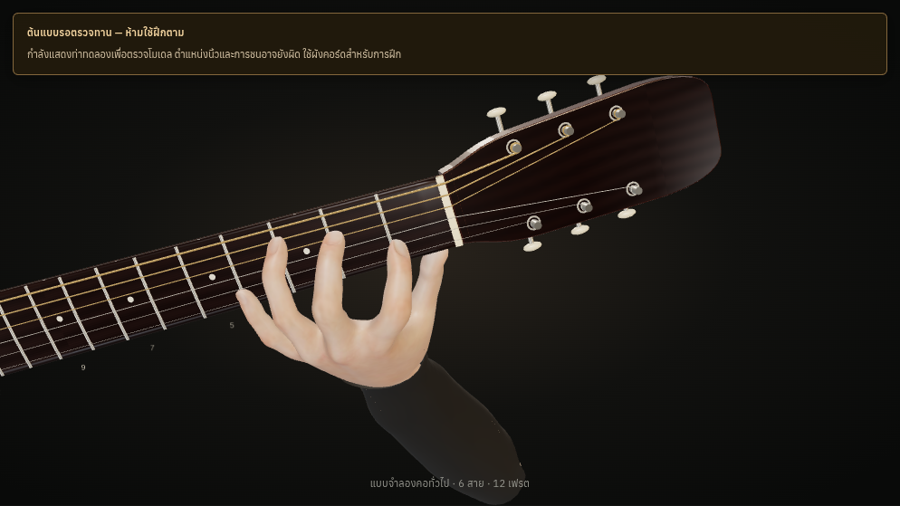
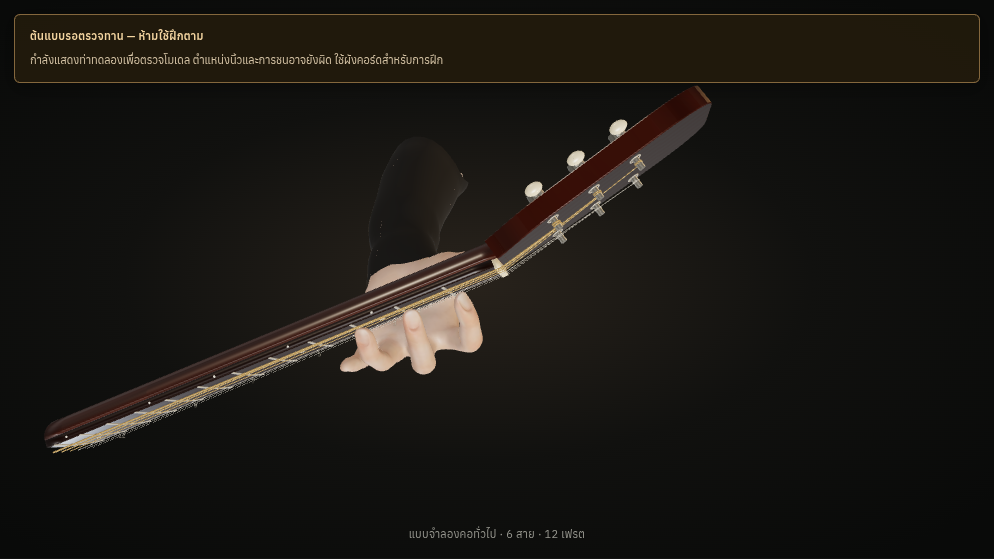
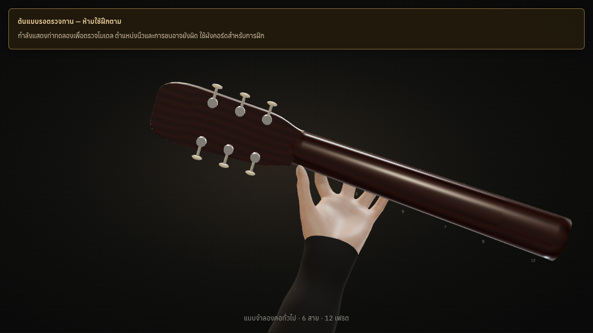
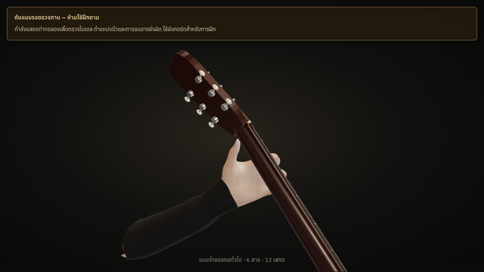
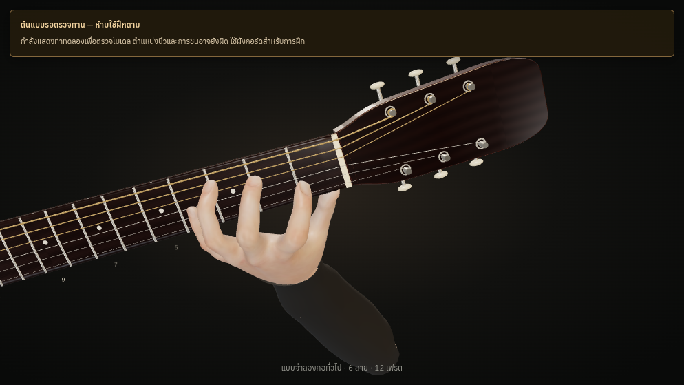
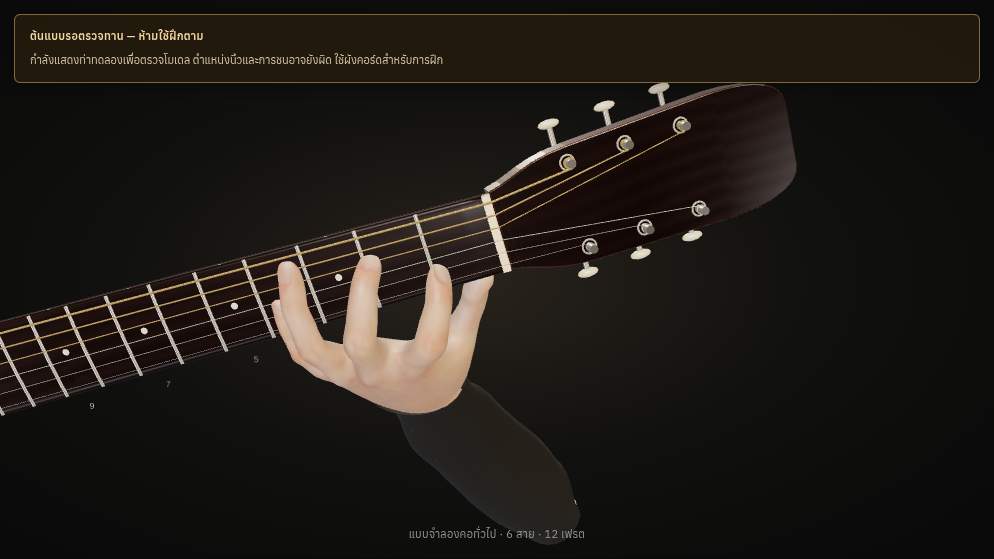

# Actual Batch 2 screenshots

These are rendered browser captures, not mockups. Every hand remains an
**unapproved prototype**. Numerical success is not natural-presentation approval.

## C — increased proximal flexion

The increased joint flexion was kept only after actual skin/garment/guitar
checks. The finite forearm termination remains visible in some views; it is not
claimed to be a completed human-arm presentation.

## Cmaj7 and Am7

Both images below are **unapproved inspection prototypes**, not teaching poses.

Actual desktop/mobile captures for both Chromium and Linux WebKit are in
[the batch capture folder](tests/reports/batch-poses/). The browser report checks
actual source-to-rendered root/bone fingerprints, open/pressed string state,
prototype warning, colour pixels, switching chords closing inspection and camera
controls. These checks do not certify ergonomics or physical iPad Safari.

## Layout and fallback

- [Desktop page](tests/reports/chromium/desktop-page.png)
- [Tablet landscape](tests/reports/chromium/tablet-landscape-page.png)
- [Mobile page](tests/reports/chromium/mobile-page.png)
- [WebKit captures](tests/reports/webkit/)

All 42 musical diagrams are unchanged. Hands are hidden in normal lessons until
approved; prototype inspection is explicit and retains the warning shown here.
