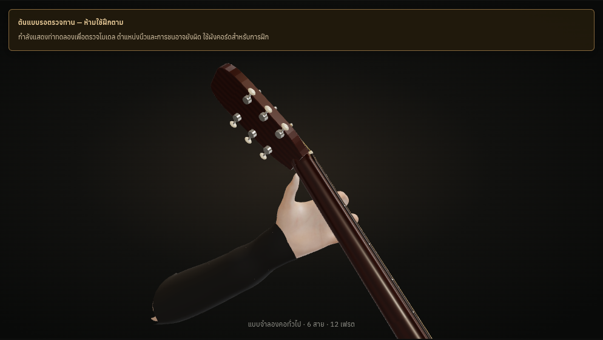

# Actual screenshots — unapproved hand inspection

Every image below comes from the frozen production WebGL build. These are actual renderings of the original rig, not photographs or generated replacement hands. **All poses remain needs-review; no teaching/anatomical approval is implied.** The paired warning images show the explicit inspection context.

## C — desktop Chromium

[Default](tests/reports/batch-poses/UNAPPROVED-chromium-desktop-C-angle.png) · [Side](tests/reports/batch-poses/UNAPPROVED-chromium-desktop-C-side.png) · [Behind neck](tests/reports/batch-poses/UNAPPROVED-chromium-desktop-C-back.png) · [Player](tests/reports/batch-poses/UNAPPROVED-chromium-desktop-C-player.png)

## Em7 — desktop Chromium

[Default](tests/reports/batch-poses/UNAPPROVED-chromium-desktop-Em7-angle.png) · [Side](tests/reports/batch-poses/UNAPPROVED-chromium-desktop-Em7-side.png) · [Behind neck](tests/reports/batch-poses/UNAPPROVED-chromium-desktop-Em7-back.png) · [Player](tests/reports/batch-poses/UNAPPROVED-chromium-desktop-Em7-player.png)

## E7 — desktop Chromium

[Default](tests/reports/batch-poses/UNAPPROVED-chromium-desktop-E7-angle.png) · [Side](tests/reports/batch-poses/UNAPPROVED-chromium-desktop-E7-side.png) · [Behind neck](tests/reports/batch-poses/UNAPPROVED-chromium-desktop-E7-back.png) · [Player](tests/reports/batch-poses/UNAPPROVED-chromium-desktop-E7-player.png)

## Fmaj7 — desktop Chromium

[Default](tests/reports/batch-poses/UNAPPROVED-chromium-desktop-Fmaj7-angle.png) · [Side](tests/reports/batch-poses/UNAPPROVED-chromium-desktop-Fmaj7-side.png) · [Behind neck](tests/reports/batch-poses/UNAPPROVED-chromium-desktop-Fmaj7-back.png) · [Player](tests/reports/batch-poses/UNAPPROVED-chromium-desktop-Fmaj7-player.png)

## Dm — desktop Chromium

[Default](tests/reports/batch-poses/UNAPPROVED-chromium-desktop-Dm-angle.png) · [Side](tests/reports/batch-poses/UNAPPROVED-chromium-desktop-Dm-side.png) · [Behind neck](tests/reports/batch-poses/UNAPPROVED-chromium-desktop-Dm-back.png) · [Player](tests/reports/batch-poses/UNAPPROVED-chromium-desktop-Dm-player.png)

## Desktop/mobile and Linux WebKit

[Full capture folder](tests/reports/batch-poses/) contains four views and warning captures for each listed chord in desktop/mobile Chromium and Linux WebKit. The [rendering report](tests/reports/batch-poses/batch-poses-browser.json) records actual source-to-rendered22-bone/root fingerprints, real pixel changes, zoom/reset and inspection closure.

The native/controlled-clock reveal captures are in [hand-reveal](tests/reports/hand-reveal/). A controlled 80 ms opacity frame is labelled as test clock manipulation; it is not a claimed physical intermediate hand pose. Linux WebKit screenshots do not establish physical iPad Safari approval.
