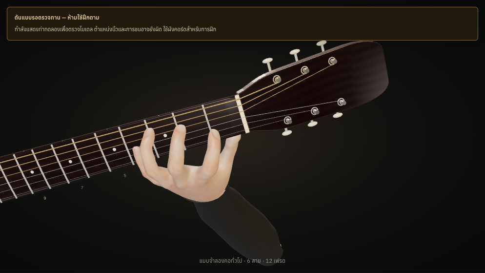
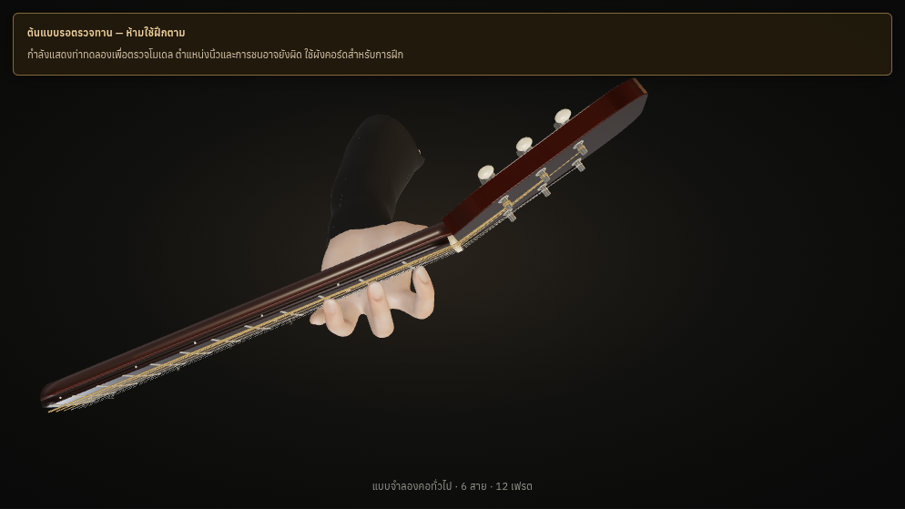
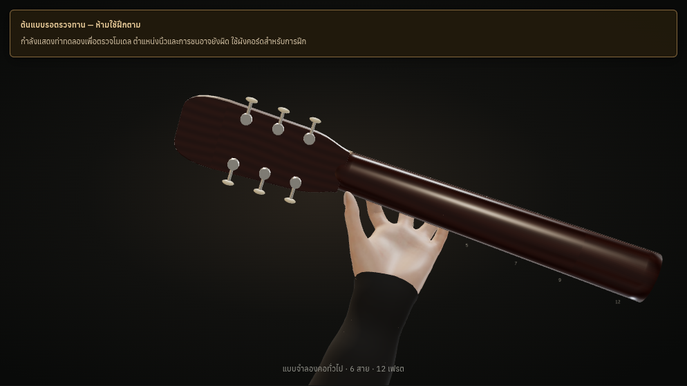
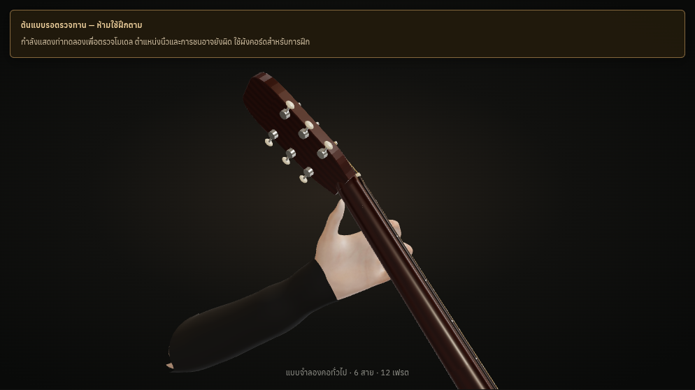
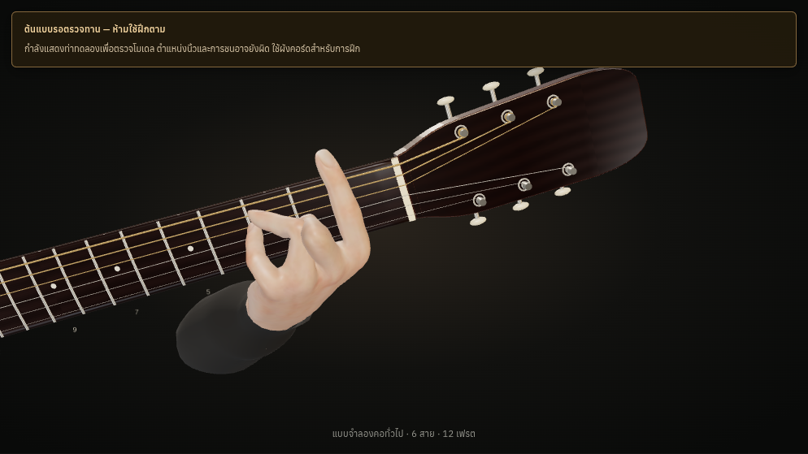

# Actual browser screenshots

Captured from the final production preview, not mockups. Full browser reports
record engine versions, source SHA and the hashes of the built assets.

**All human poses below remain needs-review.** C passes geometric contact and
collision checks but fails final visual acceptance. F is an unapproved barre
prototype with known skin collisions. Neither is an approved teaching example.

## Page layouts

| Desktop | Tablet | Mobile |
|---|---|---|
| [Full page](tests/reports/final-chromium/desktop-page.png) | [Landscape](tests/reports/final-chromium/tablet-landscape-page.png) | [Full page](tests/reports/final-chromium/mobile-page.png) |
| [3D viewport](tests/reports/final-chromium/desktop-canvas.png) | [Portrait](tests/reports/final-chromium/tablet-page.png) | [3D viewport](tests/reports/final-chromium/mobile-canvas.png) |

## C Major — four actual review views

## F barre — inspection only

## Browser evidence

- [Chromium](tests/reports/final-chromium/browser-trainer-chromium.json)
- [Linux WebKit](tests/reports/final-webkit/browser-trainer-webkit.json)
- [42-row chord evidence](tests/reports/chord-status-42.json)

WebKit on Linux does not establish physical iPadOS Safari compatibility. Use the
manual device steps in [README.md](README.md) before considering a merge.
