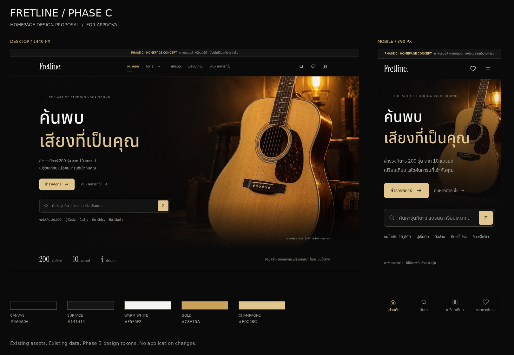

# Fretline — Phase C Homepage Mockup

**สถานะ: ภาพเสนอสำหรับอนุมัติ ยังไม่ใช่ Homepage ที่พัฒนาเสร็จ**

ใช้ Design System และไฟล์ภาพเดิมจาก application baseline [`0b187d0`](https://github.com/muhammadarifsalaeh-hue/fretline/commit/0b187d0) รอบนี้มีเฉพาะเอกสาร Mockup และภาพ render ไม่ได้แก้ React, Router, Shared Components, ข้อมูลกีตาร์ หรือไฟล์ภาพในเว็บไซต์

## ภาพสำหรับตรวจ

| ขนาด | Hero / หน้าจอแรก | Homepage ทั้งหน้า |
|---|---|---|
| Desktop 1440 × 1000 | [เปิดภาพ](homepage-desktop.png) | [เปิดภาพเต็ม](homepage-desktop-full.png) |
| Mobile 390 × 844 | [เปิดภาพ](homepage-mobile.png) | [เปิดภาพเต็ม](homepage-mobile-full.png) |
| Tablet 768 × 1024 | [เปิดภาพ](homepage-tablet.png) | [เปิดภาพเต็ม](homepage-tablet-full.png) |

ภาพ Full page บน Mobile/Tablet แสดงแถบล่าง fixed บริเวณ viewport แรกตามวิธีจับภาพของ Chromium ไม่ใช่การเสนอให้แถบล่างวางอยู่กลางเนื้อหาจริง

## แนวทางเสนอ: Quiet Signature

- **Hero:** ใช้ภาพบรรยากาศเดิมเป็นจุดเด่น ข้อความไทยสองบรรทัด เส้นและแสงทองเท่าที่จำเป็น CTA หลักก่อน Search และย้ายสถิติไปแถบเรียบใต้ Hero เพื่อไม่บังภาพกีตาร์
- **Selected Collection:** การ์ดใหญ่3ใบใน Desktop และ swipe พร้อมเห็นการ์ดถัดไปใน Mobile ใช้รูปเต็มไม่ขยายจนถูกตัด พร้อมชื่อรุ่น ราคาแบบมีแหล่งอ้างอิง และ Wishlist/Compare actions
- **Categories:** ทางเข้าครบ4ประเภทพร้อมจำนวนจริง จัดเป็นแถวกระชับ / 2×2 บนมือถือ แทน bento ที่ใช้พื้นที่สูง
- **Brands:** ชื่อแบรนด์10แบรนด์แบบตัวอักษร ขนาดและระยะเป็นระบบ ไม่เพิ่มโลโก้ และเปลี่ยน marquee เป็นรายการนิ่งที่แตะเลือกได้
- **Find My Guitar:** ข้อความชวนตอบ5คำถาม พร้อมภาพตัวอย่างหน้าตาแบบสอบถาม ไม่มีการอ้างเวลาที่ใช้หรือความแม่นยำที่ไม่ได้วัด
- **Compare:** แสดงตัวอย่างขนาดกระชับ พร้อม CTA ที่ชัดเจน เมื่อนำไปพัฒนาต้องคงรายการที่ผู้ใช้เลือก, Remove, differences toggle, table และทางเข้ารายละเอียดครบ
- **Shared identity:** สี ฟอนต์ local, controls, radii, focus และ 96/64px section rhythm อ้างอิง Phase B รักษา Navbar disclosure และลายเซ็น Footer เดิม

Micro-interactions เสนอเฉพาะสี/ขอบ/feedback 160–240ms และ reveal ที่ใช้เท่าที่จำเป็น ไม่เพิ่ม autoplay, video หรือ parallax บน touch; เคารพ `prefers-reduced-motion` ทั้ง JS และ CSS

## ภาพและข้อมูลที่ใช้จริง

| รุ่น / ภาพ | แหล่งในโปรเจกต์ | สถานะที่รักษาไว้ |
|---|---|---|
| Yamaha Pacifica 612VIIFM | `01-black.jpg` เดิม / ID `yamaha-pacifica-612viifm` | ภาพประกอบโครงงานที่ผู้ใช้อนุญาตให้ใช้ไว้เดิม ไม่อ้างเป็นรูปถ่าย/สีทางการที่ยืนยันแล้ว metadata ยังเหมือนเดิม |
| Martin D-28 | รูปเดิม / ID `martin-d-28` | IchiroNakagawa · CC BY-SA4.0 · ภาพเจ้าของเครื่องจาก2018 ไม่อ้างว่าเป็นภาพของสเปกรุ่นปัจจุบัน |
| Yamaha FG820-12 | รูปเดิม / ID `yamaha-fg820-12` | Peternick2468 · CC BY-SA4.0 · ภาพเจ้าของเครื่องที่ติดสาย6เส้นในภาพ ตามเครดิตเดิม |
| Hero | `acoustic-studio.webp` / mobile derivative เดิม | ภาพบรรยากาศทั่วไปที่สร้างไว้สำหรับ Fretline ไม่ใช้แทนรูปผลิตภัณฑ์รุ่นใด มีคำอธิบายและเครดิตในเอกสาร |

ไม่สร้างหรือค้นหารูปเพิ่ม ไม่แต่งภาพ ไม่ตัดพื้นหลัง ไม่ปรับสี ไม่เพิ่มรีวิวหรือป้าย verified; รูปจากเจ้าของเครื่องมีฉากหลังจริงซึ่งต่างจาก Pacifica artwork จึงคงลักษณะภาพตามจริง

Pacifica แสดงเฉพาะราคาเดิม **฿34,000 — ราคาขายปลีกแนะนำโดย Yamaha ประเทศไทย** อีก2รุ่นแสดง “ยังไม่มีข้อมูลราคา” ทั้ง3รุ่นยังเป็น partial

การเลือก3รุ่นนี้เป็นข้อเสนอการจัดลำดับคอลเลกชันในหน้า Home เท่านั้น FG820-12 และ D-28 ยังมี `featured:false` ตามข้อมูลเดิม ไม่แก้ข้อมูลเพื่อให้ตรงภาพ Mockup เมื่อพัฒนาต้องคงรายการเดิมและตัวกรองเดิมเข้าถึงได้ทั้งหมด

ดูรายละเอียด [Asset/content manifest](assets-and-content.json), [เครดิต FG820-12](../../../src/assets/guitars/yamaha-fg820-12/LICENSE.md), [เครดิต D-28](../../../src/assets/guitars/martin-d-28/LICENSE.md)

## การตรวจในรอบนี้

- Render เอกสารด้วย Chromium ที่1440,1024,768,390,320px: ไม่พบ horizontal overflow, broken images, console/runtime errors หรือ failed requests — [ผลตรวจ](render-check.json)
- มี3 model cards และ10 brand links; ภาพกีตาร์ใช้ `object-fit: contain`
- ตรวจภาษาไทยและแก้คำ “คุณ” ที่ตกบรรทัดเดี่ยวใน Hero/Brands บนมือถือ
- ตรวจ [Application integrity](application-integrity.json): ไฟล์แอปและข้อมูลยังตรงกับ `0b187d0` ทั้งหมด จึงรักษา200รุ่น / 10แบรนด์ / แบรนด์ละ20รุ่นและ IDs เดิม
- **ไม่ได้อ้างว่าได้ทดสอบ Homepage ใหม่ในแอป** ปุ่มตัวอย่างใน Mockup ยังไม่เชื่อมกับ ShopContext และไม่ได้ทดสอบ Safari/iPadจริง Build และ regression สำหรับ implementation จะทำหลังอนุมัติ

## งานหลังอนุมัติเท่านั้น

1. ปรับ Hero โดย reuse SearchBar/autocomplete,5quick filters,Button,HeroStats และ shared navigation
2. ปรับ Featured layout โดยคง tabs, carousel arrows/progress, swipe,keyboard,Wishlist/Compareและรายการเดิม ใช้ข้อมูลจาก catalogเดียวกัน
3. ปรับ Categories / Brands โดยคงทุกลิงก์และจำนวนที่คำนวณจาก200รุ่น
4. ปรับ Quiz / Compare entry sections โดย reuse logic และ ShopContext เดิม ไม่เอาตารางหรือการเลือกที่ทำงานได้ออก
5. ทดสอบ Build, catalog/images checks, Search,Compare,Quiz,Wishlist,URL history,focus/reduced motion และ responsive ทุกขนาด พร้อมจับ Before/After ของเว็บไซต์จริง

**หยุดรอผู้ใช้อนุมัติภาพก่อนแก้ Homepage** ไม่เริ่ม phase ถัดไปอัตโนมัติ

## เปิดดูเอกสาร Mockup ใน Codespaces

หลังดึงไฟล์เอกสารล่าสุดและเปิด Vite เดิมที่พอร์ต5173 ให้ต่อท้าย Forwarded Address ด้วย:

`/docs/signature-redesign/phase-c-proposal/homepage.html`

หน้านี้เป็นเอกสารเสนอแยกจาก route `/` ของแอป หน้าเว็บจริงยังเป็น Phase B
