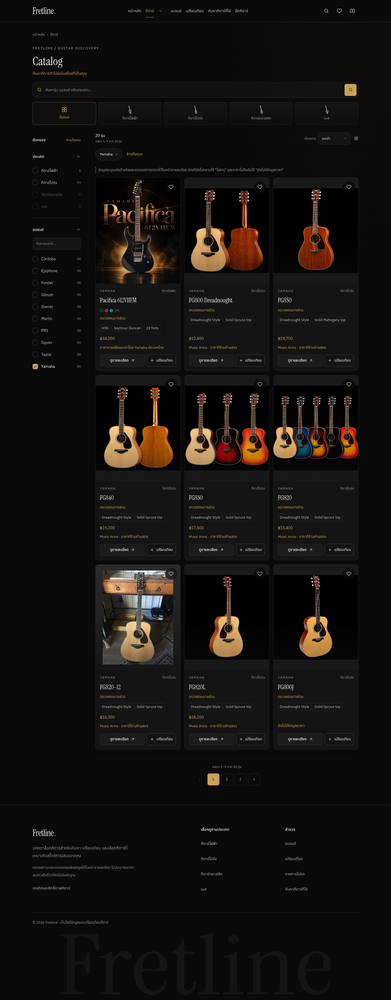
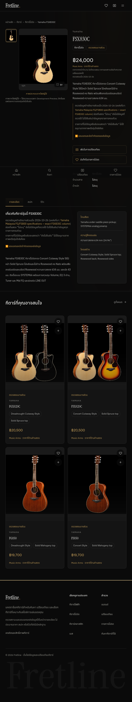
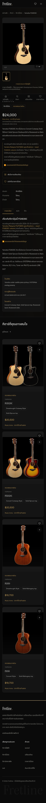

# Yamaha import — real browser screenshots

These are captures of the existing running Fretline project. New uploaded images are visible in the **explicit development preview**, not approved production product photography. No original guitar image was cropped, stretched, recolored, replaced or generated.

The final review capture first scrolls each actual lazy-loaded image into view, waits for decoding and opacity 1, and returns to the top. This avoids confusing native lazy loading with missing images in a full-page screenshot. No DOM substitution or compositing is used. [Capture record](tests/screenshots/captures.json).

## Before / After

Before: unchanged `decd554`, Chromium. After: final imported data in `yamaha-preview`; Chromium desktop and Linux WebKit touch contexts for tablet/mobile. WebKit screenshots are not a claim that physical iPad Safari was tested.

| View | Before Catalog | After Catalog | Before Detail | After Detail |
|---|---|---|---|---|
| desktop | [Before](tests/before/yamaha-catalog-desktop.png) | [After](tests/screenshots/chromium-desktop-catalog-1.png) | [Before](tests/before/fsx830c-detail-desktop.png) | [After](tests/screenshots/chromium-desktop-fsx830c.png) |
| tablet | [Before](tests/before/yamaha-catalog-tablet.png) | [After](tests/screenshots/webkit-tablet-catalog-1.png) | [Before](tests/before/fsx830c-detail-tablet.png) | [After](tests/screenshots/webkit-tablet-fsx830c.png) |
| mobile | [Before](tests/before/yamaha-catalog-mobile.png) | [After](tests/screenshots/webkit-mobile-catalog-1.png) | [Before](tests/before/fsx830c-detail-mobile.png) | [After](tests/screenshots/webkit-mobile-fsx830c.png) |

## All 20 existing Yamaha records

The Desktop catalog has three pages, 9 + 9 + 2 models. The 18 received models all display their uploaded images in Preview; Pacifica retains its previous images. FGX830C remains an explicit placeholder because its confirmed nineteenth ZIP is absent. The FG820-12 licensed primary is preserved.

- [Catalog page 1](tests/screenshots/chromium-desktop-catalog-1.png)
- [Catalog page 2](tests/screenshots/chromium-desktop-catalog-2.png)
- [Catalog page 3](tests/screenshots/chromium-desktop-catalog-3.png)

## FG800 — all three supplied files

These are separate original submitted views, selected through the real gallery thumbnails. Their back/front composite content is preserved.

| Natural | Black | Sunburst |
|---|---|---|
| [View](tests/screenshots/chromium-desktop-fg800-natural.png) | [View](tests/screenshots/chromium-desktop-fg800-black.png) | [View](tests/screenshots/chromium-desktop-fg800-sunburst.png) |

## FG820-12 and specifications

- [Original licensed image remains primary](tests/screenshots/chromium-desktop-fg820-12-licensed-primary.png)
- [New uploaded illustration as a secondary Preview view](tests/screenshots/chromium-desktop-fg820-12-uploaded-preview.png)
- [FSX830C full specification table and retailer source](tests/screenshots/chromium-desktop-fsx830c-specifications.png)

## Compare — actual 320 px regression repaired

New confirmed prices activate the existing cheapest-guitar verdict. Its grid item originally expanded the document to 344 px. Adding `min-w-0` to that existing item brings the document back to 320 px, without altering comparison logic or product data.

[Before](tests/compare-320-before-fix.png) · [After](tests/compare-320-after-fix.png)

## Desktop preview

## iPad-sized WebKit preview

## Mobile WebKit preview

